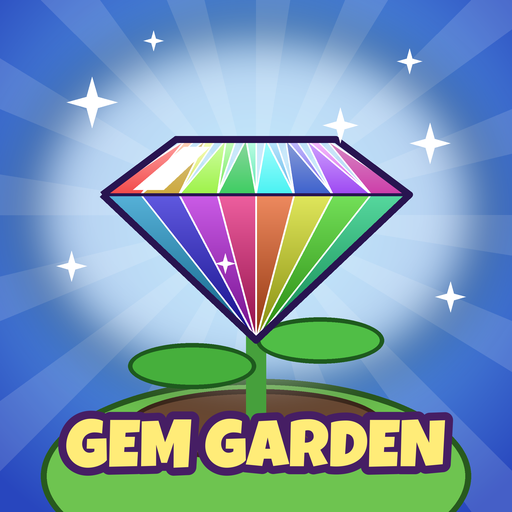
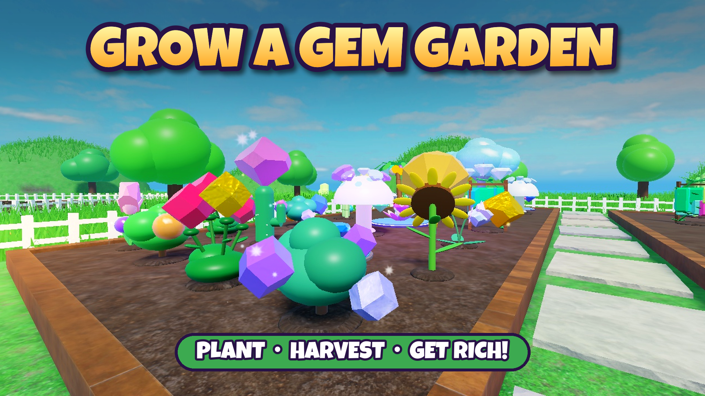
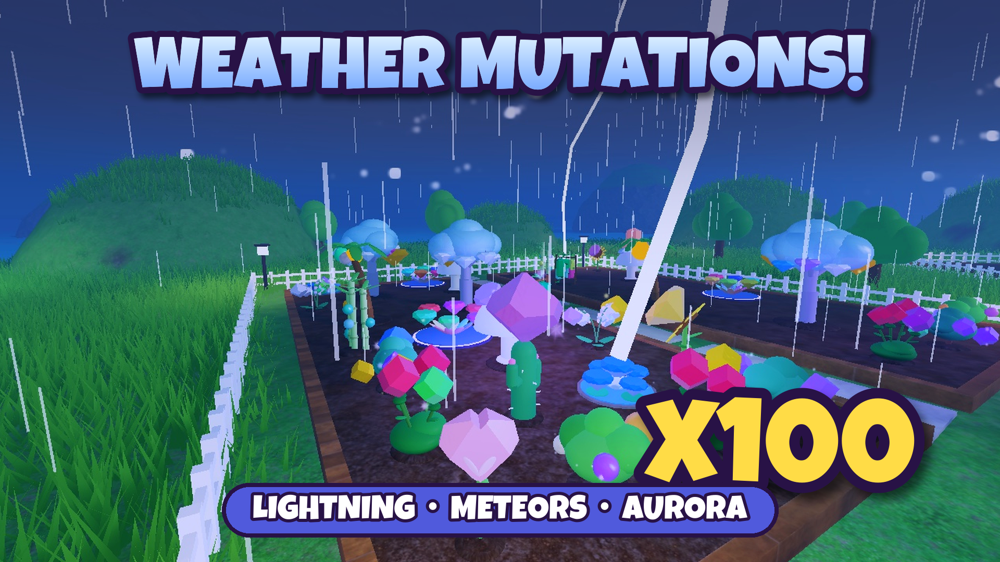
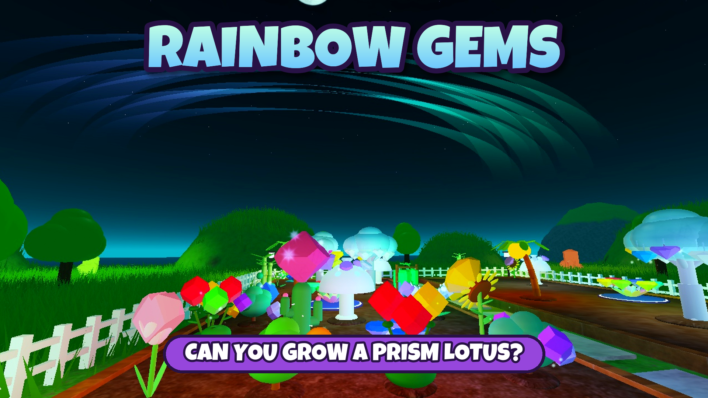

<p align="center">
  
</p>

<h1 align="center">Grow a Gem Garden 💎</h1>

<p align="center">
  A Roblox garden simulator where your plants grow <b>gems</b>.<br>
  <a href="https://www.roblox.com/games/118191458070589/Grow-a-Gem-Garden"><b>▶ Play on Roblox</b></a>
</p>

<p align="center">
  
  
  
</p>

---

## The game

Plant magical seeds, harvest the gems they grow, sell them at the Gem Trader, and buy rarer seeds. Every gem rolls its own size, and weather can mutate gems on your plants for huge multipliers.

- **15 plants** from Common to Prismatic, from Quartz Sprout to Prism Lotus. Some give one big gem; others keep regrowing.
- **8 mutations**: Golden ×20 and Rainbow ×50 roll naturally. Weather adds Glimmering ×2, Frozen ×8, Molten ×15, Charged ×30, Cosmic ×60 and Celestial ×100, and they stack.
- **6 server-wide weather events**: Glimmer Rain, Blizzard, Heatwave, Thunderstorm (lightning strikes plants), Meteor Shower (meteors hit gardens) and Aurora.
- **Personal shop stock** that restocks every 5 minutes, so rare seeds really are rare.
- **Gear**: watering cans, three kinds of sprinklers and a shovel.
- **8 gardens per server.** Your garden keeps growing while you're offline.
- **Retention**: tutorial, **daily quests** (3 a day plus a bonus), 7-day login streak, playtime gifts, promo codes, a collection index, global leaderboards, a friend sell bonus and invite rewards.
- **Look**: faceted CSG gems, procedural plants, an island built from terrain, gnome shopkeepers, and quiet licensed music (APM library).

## Monetization

| Type | Items |
|---|---|
| Game passes | VIP (249), Lucky Gardener (199), Speedy Growth (299), Super Garden (149), Big Bag (99), Sell Anywhere (149) |
| Coin packs | 25 / 99 / 399 / 1499 Robux. Amounts scale with the most expensive seed the player has bought. |
| Boosts | Grow Everything (79), Luck Potion 30 min (49), Restock Shops (29) |
| Weather | Any event for the whole server (49 to 399) |
| Seeds and gear | Any seed or gear for Robux, priced by rarity (15 to 799). The server records which item was clicked, so the receipt always grants that exact item. |
| Private servers | 99 Robux / month |
| Ads | Opt-in rewarded video ("watch an ad for a free 10-minute Lucky Boost") and two immersive ad billboards in the plaza. Both only start earning once the eligibility requirements below are met. |

Receipts are idempotent: every purchase ID is written to the player's save before Roblox is told it was granted. Product IDs live in [`src/ReplicatedStorage/Shared/Products.luau`](src/ReplicatedStorage/Shared/Products.luau).

## Promo videos

Recorded from real gameplay and edited with [`tools/make_promo.py`](tools/make_promo.py):

- [`marketing/video/promo_vertical.mp4`](marketing/video/promo_vertical.mp4): 25 s, 1080×1920, for TikTok, YouTube Shorts and Instagram Reels
- [`marketing/video/promo_landscape.mp4`](marketing/video/promo_landscape.mp4): 25 s, 1920×1080, for YouTube and the Roblox game page (`promo_landscape_web.mp4` is a smaller copy)

The videos are silent on purpose. Add a trending sound inside TikTok or Shorts when posting, which helps reach. The in-game music is licensed for Roblox only.

## Owner checklist

- [x] ID verification and 2-step verification (account reach is now **All ages**)
- [ ] **Reach 250 "highly engaged" 16+ players within 60 days.** Until then Roblox keeps the game in its 16+ trial phase. After that it opens to all ages, including younger players on Kids and Select accounts. Progress shows under Creator Hub → Audience → Reach.
- [ ] **Post the promo videos** on TikTok, YouTube Shorts and Reels. Post one per day with different captions, for example: "this Roblox garden grows GEMS 💎", "lightning hit my garden ⚡ x30", "I got a x100 aurora gem".
- [ ] **Upload the trailer** to the game page: Creator Hub → Places → Videos → Upload Video → `marketing/video/promo_landscape_web.mp4`.
- [ ] **Optional paid boosts**: [Roblox Ads](https://create.roblox.com/dashboard/advertising) sponsored campaigns, or the refundable 1,000-Robux publishing fee (Audience → Reach).
- [ ] Rewarded and immersive ads start paying automatically at 2,000 monthly players.
- [ ] Ship updates (new seed, new code, a weekend event). Players come back for new content.

## Admin commands (owner only)

```
/coins 1000            /seed ruby 5            /gear sprinkler 2
/weather aurora        /restock                /growall
/announce text...      /sellboost 50 10        (percent, minutes)
/setweather aurora     /setweather clear       (instant switch)
/strike meteor_shower  /strike thunderstorm    (hits a random garden now)
```

## Making changes

**Add a seed:** add an entry to [`Species.luau`](src/ReplicatedStorage/Shared/Species.luau) using an existing `style`, or add a new one in [`PlantBuilder.luau`](src/ReplicatedStorage/Shared/Visuals/PlantBuilder.luau).
**Add a promo code:** edit `RewardsService.Codes` in [`RewardsService.luau`](src/ServerScriptService/Server/RewardsService.luau).
**Balance:** [`Config.luau`](src/ReplicatedStorage/Shared/Config.luau), `Species.luau`, `Mutations.luau`, `Weather.luau` and `Gear.luau` hold all the numbers.

## Project layout

```
src/                         Rojo-style source of truth
  ReplicatedStorage/Shared/  game data, value math, plant + gem builders, remotes
  ServerScriptService/       server services (data, gardens, shops, weather, monetization, ...)
  StarterPlayer/...          client: UI, garden renderer, tools, weather FX, tutorial, ads
build/                       edit-time builders run inside Studio
  gems.luau, shapes.luau     CSG gem and shape assets -> ReplicatedStorage.Assets
  world.luau                 island terrain, plaza, shops, gnomes, 8 gardens, lighting
  ads.luau                   immersive ad billboards (run after world.luau)
tools/                       Node tools that drive Studio over its built-in MCP server
  studio.mjs                 tiny MCP client for StudioMCP.exe
  sync.mjs                   pushes src/ into the open place (with syntax checks)
  run.mjs                    runs a Luau file / snippet in Studio (Edit, Server or Client)
  make_icon.py, make_icons.py, make_thumbs.py   store art
marketing/                   icon, thumbnails, pass/product icons
```

### Dev loop

1. Open the place in Roblox Studio and turn on **Assistant → ⋯ → Settings → MCP Servers → Enable Studio as MCP server**.
2. `node tools/sync.mjs` pushes every script under `src/` into Studio.
3. If world or assets changed, run `node tools/run.mjs build/<file>.luau`.
4. Playtest in Studio. In Studio a `ServerStorage.DevHook` BindableFunction lets scripts drive any server service, for example `DevHook:Invoke("GardenService", "growAll", player)`.
5. Publish with **File → Publish to Roblox**.

Save data uses DataStore `GemGarden_Live_1` with session locking, autosave and a final save on shutdown.
